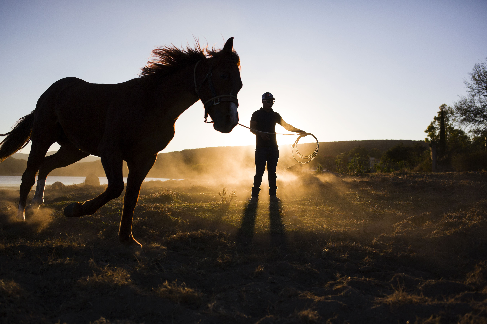

Every farm has a rhythm, and new hands learn it in different ways. This one arrives with a halter in one hand, a notebook in the other, and the kind of calm that makes even the shyest pony pause and listen.

She does not come in like a lesson. She comes in like a person who means to understand the place before she asks anything of it. The first mornings are quiet ones: watching the grass shift under a hoof, listening for the sound of a horse deciding whether to trust you, learning which corners of the field feel safe and which ones need a little more patience.

The farm has always been a place of slow work. There is no rush to get a pony moving, no need to sound impressive in front of the gate. A good session begins long before anyone speaks, and this new trainer seems to understand that instinctively. She watches first, then steps closer, then lets the horse decide how much trust belongs in the space between them.

By the second week, the pony is following her across the field without a fuss. The gate no longer feels like a border so much as a threshold, and the days begin to carry a different kind of confidence. The farm is still the same place, only now it has a new rhythm, and it seems to suit everyone very well.
